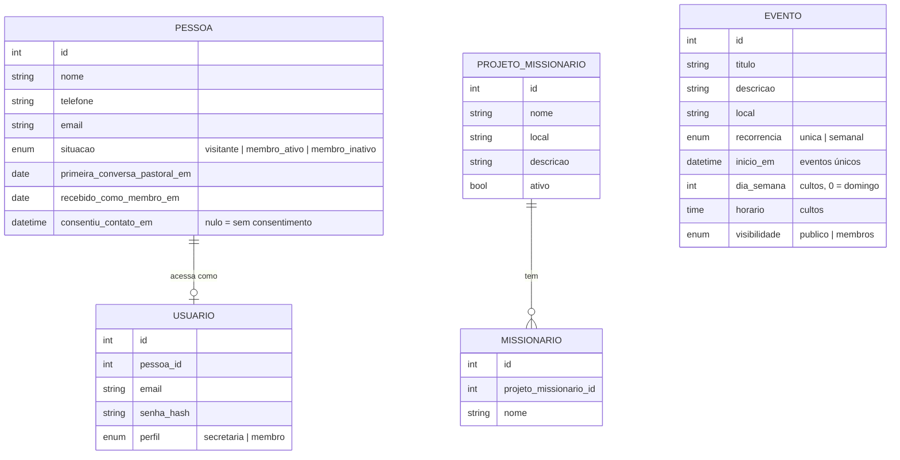

# Experiência Prática II: Fundamentação e Desenho do MVP

> Versão final para o DreamShaper (reabertura de 04 a 07/12/2026).
> Seções na mesma ordem do "Resultado do Projeto" da plataforma.
> Continua a EP I: Igreja Presbiteriana de Vila Formosa (Anápolis/GO), contato Rev. Fabrício Ribeiro.
> Onde uma atividade planejada não foi realizada no período, o documento diz isso explicitamente.

---

## 1. Identificação do aluno

- Nome: Silas Batista de Deus
- Curso: CST em Análise e Desenvolvimento de Sistemas (EAD)
- Disciplina: Projeto de Software (CVCS_EAD_2273346, Turma_001)

## 2. Identificação e conexão curricular

**Projeto:** Rebanho, um sistema web de gestão para a Igreja Presbiteriana de Vila Formosa (membros, contatos, agenda e missões).

**Conexão com o curso:**
- **Engenharia de Software / Projeto de Software:** levantamento de requisitos, histórias de usuário, MVP e priorização.
- **Banco de Dados:** modelagem entidade-relacionamento e normalização.
- **Programação Web:** aplicação MVC responsiva.
- **Segurança da Informação:** autenticação, controle de acesso por perfil e LGPD.
- **Interface Humano-Computador:** prototipação, acessibilidade e validação com usuário real.

## 3. Fundamentação e perfil do egresso

O egresso de ADS deve analisar problemas reais, projetar e implementar sistemas com responsabilidade ética e legal. Este projeto exercita:

- **Análise:** diagnóstico feito com um parceiro real (EP I), não um problema hipotético.
- **Projeto:** decisões de arquitetura proporcionais ao contexto (organização sem equipe de TI e com pouco orçamento).
- **Ética e legislação:** tratamento de dado sensível (filiação religiosa, LGPD art. 5º, II) desde a concepção.
- **Comunicação com cliente:** validação do desenho com o pastor e a secretaria antes de codificar.

**Base conceitual:**
- **MVP** (Eric Ries, *A Startup Enxuta*): o menor produto que resolve a dor principal e permite aprender com o uso real.
- **Priorização MoSCoW:** separa o essencial do desejável.
- **Privacy by design** (LGPD, art. 46): a proteção de dados entra no modelo, não como remendo.

## 4. Pesquisa de soluções existentes

| Solução | Tipo | Pontos fortes | Limitações para este parceiro |
|---|---|---|---|
| Planilha Google + grupos de WhatsApp | Improviso atual | Gratuito, todos já sabem usar | Sem controle de acesso, sem consentimento, dados duplicados, avisos se perdem |
| InChurch | App brasileiro de gestão de igrejas | App próprio, completo | Modelo de assinatura; muitas funções além do necessário |
| Planning Center | Plataforma internacional | Muito completo, modular | Interface em inglês, cobrança em dólar |
| Breeze ChMS | Sistema internacional de membros | Simples de usar | Interface em inglês, cobrança em dólar |

> Comparação feita pelas características gerais de cada solução. Preços e planos atuais não foram consultados.

## 5. Análise crítica e diferenciação

As soluções comerciais resolvem o problema, mas são **grandes demais e caras demais** para uma igreja local. A planilha é barata, mas **não protege dados nem gera informação confiável**.

**Diferenciais do Rebanho:**
1. **Regra de membresia da igreja:** alerta automático dos visitantes que completaram 6 meses de frequência. As soluções genéricas não trazem isso pronto.
2. **LGPD no centro:** o contato só aparece com consentimento registrado com data e hora.
3. **Escopo enxuto:** só o que a secretaria usa, com curva de aprendizado mínima.
4. **Custo compatível:** até R$ 50/mês de hospedagem, sem licença por usuário.
5. **Missões visíveis:** dá transparência às parcerias missionárias, o que raramente é foco das soluções comerciais.

## 6. Arquitetura lógica do software

**Monólito web MVC renderizado no servidor.** Para uma secretaria e algumas centenas de pessoas, SPA + API ou microsserviços seriam complexidade sem retorno.

```
[Celular / Navegador]
        │ HTTPS
        ▼
┌─────────────── Aplicação web ───────────────┐
│ Controllers: Pessoas, Agenda, Missões, Sessão │
│ Models: regras de negócio (RN01 a RN06)       │
│ Views: HTML responsivo e acessível            │
└───────────────────────────────────────────────┘
        │
        ▼
[Banco relacional SQLite] ── backup diário externo
```

**Camadas:**
- **Apresentação (Views):** páginas HTML. A agenda e as missões são públicas. Pessoas e contatos exigem login.
- **Controle (Controllers):** recebem a requisição, verificam o perfil e chamam o modelo.
- **Modelo (Models):** regras de negócio e persistência.

## 7. Seleção das tecnologias

| Camada | Tecnologia | Por quê |
|---|---|---|
| Runtime | **Node.js 24+** | JavaScript no servidor, ecossistema amplo, muito usado no mercado |
| Framework web | **Express** | Minimalista e consolidado: só o necessário para rotas e middlewares |
| Banco | **SQLite (módulo nativo `node:sqlite`)** | Um arquivo, sem servidor de banco e sem dependência extra. Suficiente para centenas de registros |
| Views | **EJS** (HTML renderizado no servidor) | Páginas leves, sem framework de front-end separado |
| Senhas | **`node:crypto` (scrypt)** | Hash de senha nativo do Node, sem biblioteca extra |
| Sessão | **express-session** | Login com cookie seguro (httpOnly, sameSite) |
| Estilo | CSS simples e responsivo | Sem dependência pesada |
| Testes | **`node:test`** (nativo) | Testa as regras de negócio, como a RN01, sem framework extra |
| Hospedagem | VPS simples ou plataforma gerenciada | Dentro de R$ 50/mês |
| Versionamento | Git + GitHub | Histórico e backup do código |

## 8. Modelagem simplificada dos dados

Membros, visitantes e contatos são **a mesma entidade (Pessoa)**. "Contatos" é uma consulta filtrada (membros ativos com consentimento), não uma tabela. Cultos e eventos dividem a tabela **Evento**, e o campo `recorrencia` os diferencia. O missionário guarda só o nome: o local do trabalho pertence ao projeto, e contatos pessoais de missionários ficam fora do sistema.



**Regras de negócio:**

| ID | Regra |
|---|---|
| RN01 | Visitante com primeira frequência há 6 meses ou mais está **apto à membresia**. |
| RN02 | Ao ser recebida, a pessoa passa a "membro ativo" e registra-se a data de recebimento. |
| RN03 | Visitantes e membros inativos nunca aparecem na lista de contatos. |
| RN04 | Sem consentimento registrado, telefone e e-mail não aparecem para outros membros. |
| RN05 | Agenda e missões são públicas. Pessoas e contatos exigem login. |
| RN06 | Só o perfil Secretaria cria, edita ou inativa registros. |
| RN07 | Eventos marcados "só membros" (como os PGs nas casas) não aparecem na agenda pública. Por padrão, a listagem esconde eventos restritos. |

> A confirmar com o Rev. Fabrício: se a frequência é interrompida, a contagem dos 6 meses recomeça? No MVP, a secretaria corrige a data manualmente.

## 9. Justificativa da solução técnica

- **Monólito em vez de microsserviços:** uma só aplicação para implantar, monitorar e manter. É adequado para quem não tem equipe de TI.
- **Express com HTML no servidor em vez de React + API:** uma aplicação em vez de duas, menos código para manter.
- **Recursos nativos do Node** (`node:sqlite`, `node:crypto`, `node:test`) **em vez de bibliotecas:** menos dependências significa menos atualizações de segurança e menos risco na cadeia de suprimentos.
- **SQLite em vez de PostgreSQL:** o volume (centenas de pessoas) não justifica um servidor de banco. Backup é copiar um arquivo.
- **Pessoa única em vez de tabelas separadas:** evita dados duplicados e conflitantes, que são justamente o problema diagnosticado na EP I.
- **Web responsiva em vez de app nativo:** funciona em qualquer celular sem passar por loja de aplicativos.

## 10. Requisitos funcionais priorizados

| ID | Requisito | História | Prioridade |
|---|---|---|---|
| RF01 | Cadastrar, editar e inativar pessoas | US01 | Must |
| RF02 | Filtrar pessoas por situação, com contagem | US02 | Must |
| RF03 | Listar visitantes aptos à membresia (RN01) | US10 | Must |
| RF04 | Registrar e revogar consentimento de contato | US03 | Must |
| RF05 | Cadastrar cultos semanais | US05 | Must |
| RF06 | Cadastrar eventos avulsos | US06 | Must |
| RF07 | Exibir agenda dos próximos 30 dias sem login | US07 | Must |
| RF08 | Cadastrar projetos missionários e missionários | US08 | Must |
| RF09 | Autenticar com perfis Secretaria e Membro | — | Must |
| RF10 | Exibir lista de contatos aos membros (RN03, RN04) | US04 | Should |
| RF11 | Exibir missões e missionários publicamente | US09 | Should |
| — | Finanças, escalas, células, notificações por WhatsApp | — | Won't (agora) |

## 11. Segurança e proteção de dados

- **Base legal (LGPD):** constar no cadastro de uma igreja revela convicção religiosa, que é **dado sensível** (art. 5º, II). O art. 11 não admite legítimo interesse para dados sensíveis, então a base é o **consentimento específico e destacado do titular** (art. 11, I), colhido no cadastro, com a finalidade informada. O compartilhamento do contato com outros membros é um **segundo consentimento**, separado e revogável.
- **Minimização:** só os dados necessários (nome, telefone, e-mail, datas). Sem CPF, endereço ou dados financeiros no MVP.
- **Controle de acesso:** dois perfis (RN06). Pessoas e contatos exigem login.
- **Endereços de PGs:** os pequenos grupos se reúnem em casas de membros. Esses eventos são "só membros" (RN07), e a regra é segura por padrão: a consulta esconde eventos restritos a menos que o código peça o contrário.
- **Autenticação:** senhas com hash bcrypt, bloqueio após tentativas falhas e sessão que expira por inatividade.
- **Transporte:** HTTPS obrigatório.
- **Direitos do titular:** a secretaria corrige ou exclui dados a pedido, e o membro pode revogar o consentimento.
- **Backup:** cópia diária do banco, criptografada, fora do servidor.

## 12. Desempenho e portabilidade

- **Desempenho:** páginas em menos de 2 s em conexão 4G. HTML gerado no servidor e pouco JavaScript.
- **Volume esperado:** até ~1.000 pessoas e ~200 eventos por ano. SQLite atende com folga.
- **Portabilidade de dispositivo:** funciona em qualquer navegador moderno (Chrome, Safari, Firefox) a partir de 360 px de largura.
- **Portabilidade de dados:** exportação de pessoas em CSV. A igreja não fica presa ao sistema.
- **Portabilidade de hospedagem:** roda em qualquer servidor Linux com Node.js, sem depender de um provedor específico.

## 13. Acessibilidade e conexão ao ODS

**Acessibilidade (WCAG 2.1, nível AA):**
- Contraste mínimo de 4,5:1 e fonte base de 16 px, pensando nos membros idosos.
- Navegação completa por teclado e rótulos em todos os campos de formulário.
- HTML semântico, compatível com leitores de tela (TalkBack, VoiceOver).
- Linguagem simples, sem jargão técnico.

**ODS:**
- **ODS 16, metas 16.6 e 16.10:** instituição comunitária mais organizada e transparente, com proteção de dados pessoais.
- **ODS 17, meta 17.17:** dá visibilidade às parcerias missionárias da igreja.
- **ODS 10 (redução das desigualdades):** a acessibilidade inclui idosos e pessoas com deficiência no acesso à informação da igreja.
- **ODS 3 e ODS 10:** a agenda pública divulga o projeto **Tatame na Rocha** (jiu-jítsu gratuito para crianças do bairro), ampliando o alcance de uma ação social da igreja.

## 14. Protótipo das telas principais

**Tela 1: Pessoas (Secretaria)**
```
┌──────────────────────────────────────────┐
│ Rebanho        Pessoas  Agenda  Missões  │
├──────────────────────────────────────────┤
│ [Todos][Visitantes][Ativos][Inativos]    │
│ Ativos: 128                    [+ Nova]  │
│ ⚠ 3 visitantes aptos à membresia      ▸  │
├──────────────────────────────────────────┤
│ Ana Souza     membro ativo   ✓ contato   │
│ Bruno Lima    visitante (4 meses)        │
│ Carla Dias    visitante (7 meses) ⚠ apta │
└──────────────────────────────────────────┘
```

**Tela 2: Cadastro de pessoa (Secretaria)**
```
┌──────────────────────────────────┐
│ Nova pessoa                      │
├──────────────────────────────────┤
│ Nome*            [____________]  │
│ Telefone         [____________]  │
│ E-mail           [____________]  │
│ Situação         [Visitante ▾]   │
│ 1ª frequência    [__/__/____]    │
│ ☐ Autoriza compartilhar contato  │
│   com membros da igreja          │
│            [Cancelar] [Salvar]   │
└──────────────────────────────────┘
```

**Tela 3: Agenda (pública)**
```
┌───────────────────────────────────┐
│ Agenda: próximos 30 dias          │
├───────────────────────────────────┤
│ QUA 25/11 · 19h  Tatame na Rocha  │
│ DOM 29/11 · 09h  Culto Público    │
│ DOM 29/11 · 10h  Escola Dominical │
│ DOM 29/11 · 19h  Culto Público    │
│ (PGs só aparecem para membros)    │
└───────────────────────────────────┘
```

**Tela 4: Missões (pública)**
```
┌────────────────────────────────┐
│ Missões que apoiamos           │
├────────────────────────────────┤
│ ▸ Plantação de igreja · Uruguai│
│   Missionários: Rev. Maurício  │
│   Rolim e Sandra Rolim         │
│ ▸ Asas de Socorro              │
│   Missionário: Wilker Mariano  │
└────────────────────────────────┘
```

> Horários dos cultos e missões informados pela igreja, que apoia também outros projetos além dos dois listados. As telas implementadas estão em `docs/evidencias/` (EP III).

## 15. Registro e descrição das interfaces

| Tela | Perfil | Objetivo | Elementos principais | Requisitos |
|---|---|---|---|---|
| Pessoas | Secretaria | Ver e filtrar o quadro de membros | Filtros por situação, contagem, alerta de aptos, lista | RF01, RF02, RF03 |
| Cadastro de pessoa | Secretaria | Incluir ou editar pessoa | Formulário, caixa de consentimento | RF01, RF04 |
| Contatos | Membro | Falar com outros membros | Lista com nome, telefone e e-mail (só com consentimento) | RF10 |
| Agenda | Público | Saber dos cultos e eventos | Lista cronológica de 30 dias | RF05, RF06, RF07 |
| Missões | Público | Conhecer as missões apoiadas | Projetos com seus missionários | RF08, RF11 |
| Login | Secretaria e Membro | Acessar áreas restritas | E-mail, senha | RF09 |

## 16. Roteiro da validação prática

1. **Apresentação** (15 min): mostrar as telas ao Rev. Fabrício e à secretaria.
2. **Tarefas guiadas:** pedir que a secretaria, olhando o protótipo, explique como faria:
   - T1: cadastrar um visitante novo;
   - T2: descobrir quantos membros ativos existem;
   - T3: encontrar quem está apto à membresia;
   - T4: cadastrar o culto de domingo;
   - T5: cadastrar uma missão com seu missionário.
3. **Perguntas:** o que falta? O que sobra? A regra dos 6 meses está correta?
4. **Registro:** anotar acertos, dúvidas e ajustes pedidos.

**Situação:** a validação do protótipo com a igreja **não foi realizada no período**. O desenho seguiu direto para a implementação (EP III), incorporando as informações levantadas junto à igreja. O roteiro acima foi ampliado para 7 tarefas e reaproveitado no roteiro de validação do sistema pronto.

## 17. Critérios de aceitação mensuráveis

| Critério | Meta |
|---|---|
| Secretaria entende como fazer cada tarefa T1 a T5 sem ajuda | ≥ 4 de 5 tarefas |
| Tempo estimado para saber o nº de membros ativos | < 1 minuto (linha de base não medida) |
| Visitantes aptos à membresia identificados automaticamente | 100% |
| Contatos exibidos sem consentimento | 0 |
| Telas que passam no verificador de contraste WCAG AA | 100% |
| Satisfação do parceiro com o protótipo (1 a 5) | ≥ 4 |

## 18. Revisão da experiência prática

O desenho manteve o que a EP I propôs e acrescentou a regra RN07, porque os Pequenos Grupos acontecem nas casas dos membros e os endereços não podem ficar públicos. O modelo de dados ficou com 5 tabelas e uma única entidade Pessoa para membros, visitantes e contatos. Na revisão final, a base legal da LGPD foi corrigida: dado de filiação religiosa é sensível e exige consentimento, não legítimo interesse. Sem a validação do protótipo, nenhum ajuste veio diretamente do parceiro nesta etapa.

## 19. Autoavaliação e reflexão

> Rascunho baseado no que aconteceu no projeto. Leia e ajuste com as suas palavras.

O mais difícil foi resistir a uma arquitetura maior do que o problema. Um monólito com SQLite atende uma igreja local com custo quase zero. Na LGPD, aprendi que a base legal depende do tipo de dado: num cadastro de igreja, tudo é sensível. Faria diferente: mostraria os wireframes à secretaria antes de codificar.
